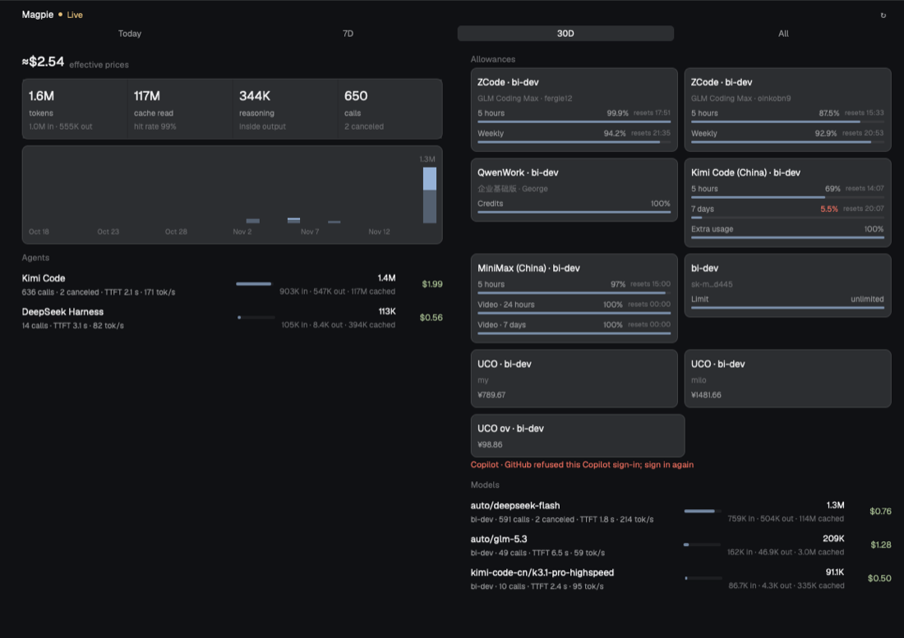

# Magpie stats

A Herdr panel that copies magpie's Usage page: the allowance cards with their
windows, pace and trend curves, the spend, four headline tiles, a token chart,
and every agent, model, account and gateway key that routed traffic. It opens
from the window's + menu as a tab, or docks in a sidebar, and it adapts its
layout to the width it is given. The content uses the page's own light and
dark palette; the header and period row keep Herdr's theme.

## What you see

The panel has four width tiers. Below 160 px it is a rail. Below 420 px it is
narrow. Below 760 px it is medium. At 760 px and above it is wide. At every
size the content flows in one column, as the page does. Medium caps it at
560 px; wide caps it at 1200 px, the page's own view width. Only the
allowance cards and the KPI strip divide into columns inside that flow.

- Header row. The selected gateway's name in semibold (the built-in one is
  named "Magpie"; click the name to switch or add gateways), a status word
  with a colored dot (Live, Stale, Offline or Unavailable), a 5 px dot per
  other watched gateway, and a refresh control (↻) that spins while a request
  is in flight.
- Gateway picker. Click the header name. One row per gateway, with its status
  dot and a `✕` to remove it. `+ Add gateway` opens a form with two type
  buttons, **Address file** and **URL + key**. Address file asks for Name and
  Address file. URL + key asks for Name, URL, and API key. A failure keeps
  what you typed and says why inline.
- Period row. Four equal segments, Today / 7D / 30D / All. The selected one
  has the raised background. 30D is the default.
- Cost line. `≈$2.54` in semibold, beside `effective prices`, or
  `N calls unpriced` when some calls had no known price.
- Allowances. Cards packed into columns the way the page packs them: each
  card goes into the shortest column, as many as fit (three at the wide cap),
  one in narrow. A provider's several accounts share one card with an `All N
  accounts` aggregate block and a section per account. A card head carries
  the provider icon, the name, and the plan with its renewal or expiry. Each
  window shows its name, `count / limit · N% used` (or left, by the Used/Left
  switch in the head), a 3 px bar, `Resets HH:MM · in Nh · Pace ±N%`, and
  `Whole ≈ N tokens · ≈ $C` from the window's holds. A balance account shows
  `Balance` and the amount, with an amber `As of …` when the reading stands
  in for a failed one. A refused account keeps its error line.
- Trend curves. Under an account's windows, `Left over time` plots each
  window's left percentage over its current cycle, with a dashed projection
  to the reset, a dashed now line, the cycle's start and end under the plot,
  a legend dot per window with its last left percentage, and `Updated …`.
  The head says `Runs out … at this pace` or `Lasts past the reset at this
  pace`. Accounts with no history draw no curve.
- Tiles. Four of them: tokens (input plus output, with `in · out` under),
  cache read (with `hit rate N%`), reasoning (`inside output`), and calls
  (with failed, retried, canceled and unpriced counts). Uppercase labels,
  20 px values, white cells with 1 px gaps in a rounded bordered strip.
  Narrow stacks them two by two. Medium and wide keep one row.
- Chart. One bar per hour, day, or week, with input stacked dim under output.
  The height follows the tier: 32 px, 56 px, or 72 px. A peak label sits at
  the right, about six date labels under the bars, and a hover gives the
  bucket's tokens, calls, and cost. An empty period shows "No calls in this
  period".
- Agents. One row per agent, all of them, in a white card. A 16 px icon, the
  name, and a wrapped sub-line: provider, calls, credits, failed, looped,
  retried, canceled, mean first token (TTFT), decode speed, timed replies,
  and any calls magpie made by itself. A 4 px bar shows its share of the
  period's tokens. The right side is the token count with
  `in · out · cached · hit rate N%` under it, and the green cost, `≈$0.807`
  style, with a `+` when some calls had no price. A model with nothing priced
  shows no cost.
- Models, Accounts, Gateway keys. The same row shape, in that order. Accounts
  and Gateway keys appear only when the gateway reports any. Each list head
  is uppercase with a chevron that folds the list away; the fold is remembered.
- Footer. `Counted from the providers' own usage reports on every call through
  the gateway · <path>`.
- Narrow rows stack. Name and cost come first, then the sub-line, then the
  share bar and the token count.
- Rail. In a sidebar narrower than 160 px the panel is the selected gateway's
  first letter with its status dot, one dot per other gateway, and a refresh
  click.

## How it behaves

- Live. The selected period refreshes every 30 seconds, and on first show.
  Each gateway keeps its own states and its own selected period. A failure on
  one gateway never touches another's numbers.
- Allowances. Fetched with the same cycle from `/v1/magpie/quotas`, with the
  provider icons from `/v1/magpie/quotas/cards` and the curves from
  `/v1/magpie/quotas/history?days=45`. A gateway answers its own accounts'
  history only, so the panel also reads each remote magpie named in
  `~/.config/magpie/providers.json` (`preset: "remote-magpie"`, not off) with
  that provider's key, and prefixes its entries with the provider id, the way
  magpie's own page merges them. A missing cards or history endpoint leaves
  the panel without icons or curves, never in an error state. Quota is not
  period-scoped, so switching periods leaves it alone. A failure after a
  success keeps the last cards and marks the title stale. A first failure
  shows `Quota unavailable`. Usage stays visible either way.
- Used/Left. The switch in the Allowances head flips every window's figure
  and bar between used and left. The choice is remembered in localStorage.
- Pace. `used − 100·(now−start)/(reset−start)`, the start taken from the
  window's newest history point. Over an even pace reads amber `+N%`, under
  reads `−N%`. Without a start and a reset there is no pace.
- Key gateways. A key instance sends `Authorization: Bearer <key>` only to
  its own origin. A 401 or 403 reads `the gateway refused the key`. The key is
  masked in the form and never drawn.
- Period switch. Clicking a segment shows that period from its cache and
  refreshes it when the data is older than 30 seconds. A late answer for a
  period you left updates only that period's cache.
- Refresh click forces a fetch of the selected period and the allowances. The
  control spins while the request is in flight.
- Failure after success. The last numbers stay, the status becomes Stale, and
  a footer reads `Can't refresh · updated 14:32`. Hover it for the reason.
- Gateway down. One quiet state instead of numbers: "Magpie isn't running"
  when a file gateway's address file is gone, "Magpie isn't answering" when
  the connection fails, "Magpie usage is unavailable" when the answer is not
  usable usage data. Recovery is automatic.
- Nothing opens anything. Rows and bars are not clickable. A key instance
  sends its key only to its own gateway's origin.

## Built from

- `mods/magpie-stats/main.js` plus five provider icons (`kimi.svg`,
  `deepseek-color.svg`, `magpie.svg`, `githubcopilot.svg`, `zcode.png`).
  `mod.json` is `{"place": "none"}`, so it never docks by itself. Open it from
  the + menu as a tab, or place a block by hand:
  `{"id": "magpie", "type": "block", "size": {"px": 240}, "min": 60, "content": {"mod": "magpie-stats"}}`.
- The + menu needs two clones of shipped mods. The + button in `tabs`
  hardcodes `openOverlay({ mod: "new-menu" })`, and shipped mods are rewritten
  on every start, so patch copies:
  - `mods/magpie-tabs/main.js`: the `tab-new` button opens `magpie-menu`.
  - `mods/magpie-menu/main.js`: one row after Terminal,
    `run("tab.new", { name: "Magpie stats", space: space?.id, mod: "magpie-stats" })`,
    and the fixed height constant 167 becomes 198.
  - The shown layout's tabs block names `magpie-tabs`.
- herdr functions used: `home()`, `appHome()`, `readTextFile()`,
  `writeTextFile()` (compare-and-swap), `theme()`, `InputState`/`Input` from
  gpui-base, the built-in `fetch` with a `headers` option, and gpui-kit's
  `PathBuilder` with `window.paint_path` for the curves. No app commands, no
  `exec`, no programs.
- Watch list: `<appHome>/magpie-stats-instances.json`, one of two shapes per
  entry: `{"id":"i-…","name":"…","kind":"file","addressFile":"…"}` or
  `{"id":"i-…","name":"…","kind":"key","url":"http://host:port","key":"…"}`.
  A missing `kind` reads as `file`. The list is written only through a
  compare-and-swap read-merge-write with a bounded retry, so several copies
  share one list safely. The built-in Magpie gateway is derived, never stored.
- Data source per gateway: `GET {origin}/v1/magpie/usage?period=today|7d|30d|all`,
  `GET {origin}/v1/magpie/quotas`, `GET {origin}/v1/magpie/quotas/cards`, and
  `GET {origin}/v1/magpie/quotas/history?days=45`, plus each remote magpie's
  history with its own key. A file instance reads its address file on every
  request and accepts loopback hosts only. A key instance uses its stored
  origin and sends `Authorization: Bearer <key>`. The page's own code is
  `internal/gui/assets/plugins/usage/` and `app.js` in magpie's source.
- Structure: one `UsagePageSnapshot` per period with totals, chart points, and
  four row lists. One `parseUsageRow` validates all four lists. One
  `tierOf(width)` decides the layout tier. A quota state of four kinds sits
  beside each gateway's period map, owned by the runtime captured before each
  fetch. Allowance cards are measured with `on_size_change` and packed into
  the shortest column, as the page's `packUsage` does.
- Palette: `pagePalette()` picks the page's light or dark pair by the
  luminance of Herdr's background color. The content area uses it; the header
  and period row keep Herdr's tokens.
- Width constants: `RAIL_WIDTH` 160, `NARROW_WIDTH` 420, `MEDIUM_WIDTH` 760,
  `COLUMN_WIDTH` 560, `PAGE_WIDTH` 1200. Change these to retune the layout.

## Watch out

- Scope. This copies the Usage page's Overview. The Requests, Sessions and
  Context tabs are separate views and are not copied. Row actions (hide an
  agent, set a model price, clear usage), the Cards/Table switch, Hide
  accounts, the Trends range menu, and Warm up are not copied. The panel is
  read-only apart from the Used/Left switch and the list folds.
- Curves need history. A gateway's history endpoint answers its own accounts
  only; a remote account's curve comes from that remote magpie, read with the
  key in `providers.json`. An account with no readings draws no curve, and a
  window with no recorded start draws no pace.
- Tokens count input plus output, as the page does by default. Cache read and
  written sit in the tooltips and row sub-values, not in the token totals.
- File gateways stay loopback only. A key gateway may point at any http or
  https origin; the key leaves this machine only to that origin. Do not add a
  key for a gateway you do not control.
- Keys sit in plain text in the watch list file under the app home. Treat that
  file as a secret.
- The shipped + button and menu are rewritten on every start. The Magpie row
  lives in the two clones, so fixes to the shipped `tabs` or `new-menu` do not
  reach them until you re-apply the three lines.
- A key URL is an origin only. Paths, queries, fragments, and credentials are
  rejected.
- Each gateway's address file is re-read on every refresh, so a gateway
  restarted on a new port heals within one cycle. Do not cache it.
- Added address files must be absolute paths inside the user's home (`~`
  expands).
- The runtime's JavaScript has no locale data. The formatters (cost,
  thousands grouping, clock time, token counts) are hand-written. Keep them
  that way.
- The chart keeps the last 30 series points. A longer period shows the last 30
  buckets while the totals cover everything.
- Responses over Herdr's 8 MiB fetch cap fail into the unavailable state.
  Period payloads here measure 6 to 14 KB.
- Redirects are rejected (`response.url` must equal the request), so a proxy
  or captive portal becomes "unavailable" rather than trusted output.

## Done when

- `herdr-app check ~/.config/herdr-app/mods/magpie-stats` passes.
- The + menu lists Magpie stats and opens it as a tab. The sections flow in
  one column at every width, as on the page. Allowances come before the tiles
  and the chart, Models below Agents, capped at 1200 px wide. Narrowing the
  pane shrinks the card grid, and below 160 px it becomes the rail.
- With magpie running, the panel shows Live, the cost and calls match
  `curl -s "http://127.0.0.1:3425/v1/magpie/usage?period=30d"`, and the
  allowance cards match `curl -s "http://127.0.0.1:3425/v1/magpie/quotas"`.
- The Agents, Models, Accounts and Gateway keys lists show every row the
  gateway reports, with its tokens, share, and cost.
- Adding a key gateway against a gateway that requires a key shows that
  gateway's numbers. A wrong key reads `the gateway refused the key`.
- Switching periods twice quickly leaves the second period's numbers on
  screen.
- Stopping magpie keeps the last numbers with a Stale status and the
  `Can't refresh` footer, and the quiet down states recover on their own.
- `node .kimi-code/skills/verify-magpie-stats-registry/check.mjs` prints
  `all properties hold on the real code`, and `unit.mjs` prints
  `26 passed, 0 failed`.
